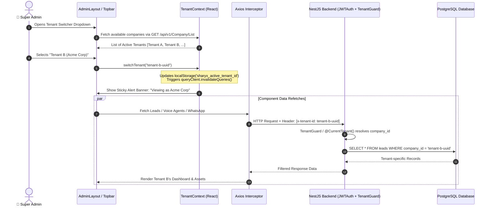

# 🏛️ Super Admin Multi-Tenant Switching & Impersonation Engine
## Comprehensive Architecture & Technical Implementation Plan

---

## 1. Executive Summary

In **workforce_Sharyx**, the Super Admin requires the capability to monitor, manage, and debug client workspaces **tenant-by-tenant**. 

Currently:
- The tenant switcher dropdown in `frontend/src/pages/admin/AdminLayout.tsx` contains static mock strings (`['Acme Innovations Ltd', ...]`) and only toggles a local label.
- Downstream modules (Voice AI Agents, WhatsApp Campaigns, Email Inbox, Leads, Candidates, Customers, and Analytics) do not respond to tenant changes.
- Backend queries lack a dynamic, secure multi-tenant scoping mechanism triggered by Super Admin impersonation headers.

### Objective
Build a production-grade, secure **Tenant Switching & Contextual Scoping Engine** that:
1. Allows Super Admins to dynamically select any registered company/tenant or select **"All Tenants (Global Platform View)"**.
2. Automatically propagates the active tenant across the frontend via a unified `TenantContext` and Axios request interceptor (`x-tenant-id`).
3. Enforces multi-tenant data isolation on the backend via NestJS decorators/interceptors while permitting Super Admin impersonation.
4. Provides clear visual UI cues (e.g. Impersonation Banner, quick tenant switcher, and cache reset).

---

## 2. Target System Architecture



---

## 3. Database & Multi-Tenant Data Scoping

### 3.1 Entity Relationship & Scoping Strategy
All business entities must have or reference `company_id` (UUID):
- `user` -> `company_id` (or joined via tenant membership)
- `leads` -> `company_id`
- `voice_agent` -> `company_id`
- `whatsapp_campaign` -> `company_id`
- `customer` -> `company_id`

### 3.2 Backend Decorator: `@CurrentTenant()`
Located in `backend/src/Helper/Common.helper.ts`:

```typescript
import { createParamDecorator, ExecutionContext, ForbiddenException } from '@nestjs/common';

export const CurrentTenant = createParamDecorator(
  (data: unknown, ctx: ExecutionContext) => {
    const request = ctx.switchToHttp().getRequest();
    const user = request.user; // populated by JwtAuthGuard

    const isSuperAdmin = user?.user_role_name?.toLowerCase().includes('super') ||
                         user?.role?.toLowerCase().includes('super');

    // 1. If Super Admin: allow header override
    if (isSuperAdmin) {
      const requestedTenantId = request.headers['x-tenant-id'];
      if (requestedTenantId && requestedTenantId !== 'all') {
        return requestedTenantId;
      }
      return requestedTenantId === 'all' ? null : user.company?.id || null;
    }

    // 2. Regular user: strictly enforce their own company
    return user.company?.id || request.user?.company_id;
  },
);
```

### 3.3 Backend Companies API
Enhance `backend/src/Controller/Admin/Company.controller.ts`:
- `GET /api/v1/Company/List`: returns active companies (`id`, `name`, `email`, `status`, `created_on`, `user_count`, `active_agents_count`).
- Accessible by Super Admin to populate tenant selector options.

---

## 4. Frontend Architecture

### 4.1 Global `TenantContext`
File: `frontend/src/context/TenantContext.tsx`

```typescript
export interface Tenant {
  id: string;
  name: string;
  code?: string;
  logo?: string;
  status?: boolean;
}

interface TenantContextType {
  selectedTenant: Tenant | null; // null represents "All Tenants"
  tenants: Tenant[];
  isLoadingTenants: boolean;
  isSuperAdmin: boolean;
  isImpersonating: boolean;
  switchTenant: (tenantId: string | null) => void;
  refreshTenants: () => Promise<void>;
}
```

Key features:
- Automatically reads `localStorage.getItem('sharyx_active_tenant_id')` on boot.
- If Super Admin switches tenant, triggers `queryClient.invalidateQueries()` so every active React Query immediately refreshes without needing a manual window reload.

### 4.2 Axios Request Interceptor
In `frontend/src/lib/api.ts` or `frontend/src/lib/auth.tsx`:

```typescript
axios.interceptors.request.use((config) => {
  const activeTenantId = localStorage.getItem('sharyx_active_tenant_id');
  if (activeTenantId) {
    config.headers['x-tenant-id'] = activeTenantId;
  }
  return config;
});
```

### 4.3 Top Navigation Bar Switcher (`AdminLayout.tsx`)
1. **Dynamic Dropdown**:
   - Replaces hardcoded strings with `tenants` loaded from `useTenant()`.
   - Includes search input for quick tenant lookup (vital when hosting 20+ tenants).
   - Includes **"🌐 All Tenants (Global View)"** option for platform-wide metrics.
2. **Permission Check**:
   - If user is NOT Super Admin: The dropdown is locked into a static company badge showing only their assigned workspace.

### 4.4 Sticky Impersonation Alert Banner
Rendered directly above the main page router when `isImpersonating` is true:
```tsx
{isImpersonating && (
  <div className="bg-amber-500/10 border-b border-amber-500/20 px-6 py-2 flex items-center justify-between text-xs text-amber-700 dark:text-amber-300">
    <div className="flex items-center gap-2">
      <ShieldAlert className="h-4 w-4 text-amber-500" />
      <span>
        <strong>Super Admin Impersonation:</strong> Currently viewing workspace for <u>{selectedTenant?.name}</u>
      </span>
    </div>
    <div className="flex items-center gap-3">
      <button onClick={() => switchTenant(null)} className="underline hover:text-amber-900 font-semibold">
        Reset to Global View
      </button>
    </div>
  </div>
)}
```

---

## 5. Phased Implementation Roadmap

### Phase 1: Context & State Foundation
- [ ] Create `frontend/src/context/TenantContext.tsx`
- [ ] Connect `TenantProvider` in `frontend/src/App.tsx`
- [ ] Inject `x-tenant-id` into Axios request interceptors

### Phase 2: Topbar UI & Dropdown Enhancement
- [ ] Replace static mock array in `frontend/src/pages/admin/AdminLayout.tsx` with `useTenant()`
- [ ] Add search filter inside the dropdown popover
- [ ] Add "All Tenants" global option
- [ ] Add Impersonation Banner with "Reset to Global View" button

### Phase 3: Backend Tenant Scope Enforcement
- [ ] Implement `GET /api/v1/Company/List` in `Company.controller.ts` & `Company.service.ts`
- [ ] Implement `@CurrentTenant()` decorator in `Common.helper.ts`
- [ ] Apply tenant filtering to Lead, Voice Agent, WhatsApp, and Customer controllers

### Phase 4: Verification & Edge Cases
- [ ] Test switching between Tenant A and Tenant B: confirm Leads and Voice Agents update instantly
- [ ] Test regular (non-super-admin) user: confirm dropdown is locked and headers cannot be spoofed
- [ ] Test page reload: verify selected tenant persists in `localStorage`

---

## 6. Security & Audit Rules
1. **Header Validation**: Non-super-admin requests attempting to pass `x-tenant-id` different from their own token company ID must be silently discarded or rejected with `403 Forbidden`.
2. **Audit Logging**: Every action performed by a Super Admin while impersonating a tenant must record:
   - `performed_by_id`: Super Admin User ID
   - `impersonated_tenant_id`: Selected Company ID
   - `action`: Created/Updated/Deleted

